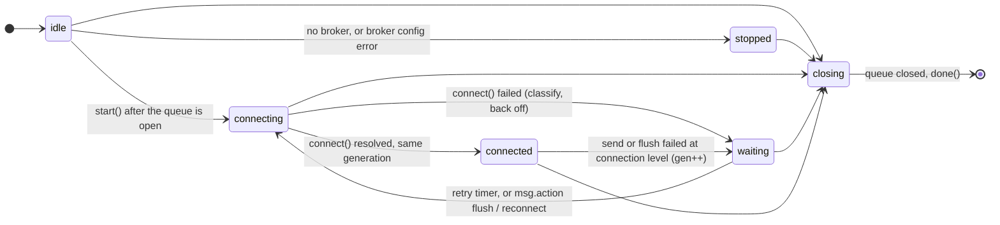
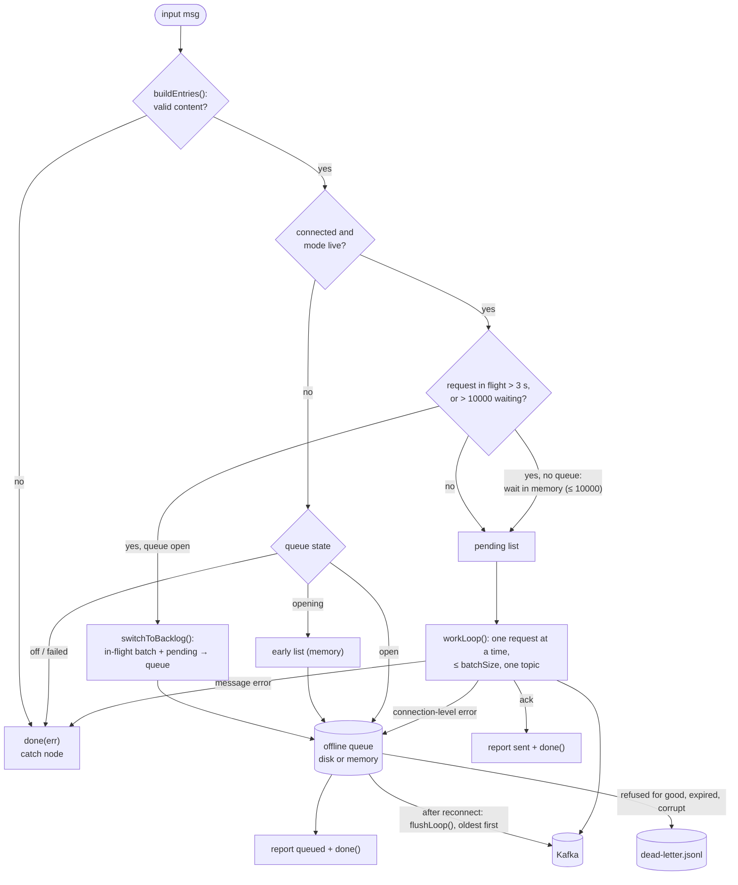

# Architecture

This document is for contributors. It explains how the nodes are built and why: which module does what, how a
node that talks to Kafka is structured, how errors are classified, and which kafkajs behaviours the code works
around. What the nodes do for users is described in the [README](../README.md). The offline queue has its own
document, [OFFLINE-QUEUE.md](OFFLINE-QUEUE.md).

- [Design goals](#design-goals)
- [Module map](#module-map)
- [Anatomy of a client node](#anatomy-of-a-client-node)
- [The producer](#the-producer)
- [The consumer](#the-consumer)
- [The admin node](#the-admin-node)
- [Error classification](#error-classification)
- [The safety net, and why it is narrow](#the-safety-net-and-why-it-is-narrow)
- [kafkajs pitfalls we work around](#kafkajs-pitfalls-we-work-around)
- [Testing strategy](#testing-strategy)

## Design goals

Node-RED runs every flow in one process. It installs a handler for uncaught exceptions that logs the error and
calls `process.exit(1)`, and it installs no handler for unhandled promise rejections, so on Node.js 15 and later
those end the process too. One forgotten `.catch()` in one node stops every flow on the instance. The palette this
project replaces did exactly that whenever its first connection failed.

So everything here follows from a few rules:

1. **Never crash Node-RED.** No exception or rejection may escape into the event loop, whatever Kafka, the network,
   the configuration or the incoming messages do.
2. **Never give up.** Lost connections are retried forever, with backoff. Problems that need a person (wrong
   password, missing ACL, untrusted certificate) are retried slowly instead of being abandoned.
3. **Never lose a message silently.** A message is either delivered, stored in the offline queue, or failed with
   `done(err)` so that a *catch* node sees it. The only exceptions are the limits the user configures.
4. **Say what is wrong.** One clear status text and one log line per problem, not hundreds.
5. **Install anywhere.** Only pure JavaScript dependencies (kafkajs 2.2.4 pinned exactly, kafkajs-snappy, lz4js),
   Node.js 18.5 or newer, Node-RED 3.1 or newer (3.0 gives nodes inside subflows a new id on every start, and the
   default queue directory and consumer group are derived from the id).

## Module map

### `lib/`: shared modules (no Node-RED dependency)

Every exported function in `lib/` is written so that it cannot throw on bad input, unless its documentation says
otherwise. They are used inside timers, event handlers and close handlers, where a throw would be a crash.

| Module | Responsibility | Main exports |
|---|---|---|
| [`util.js`](../lib/util.js) | Small helpers: parse numbers and booleans from editor strings, `safeOn()` for kafkajs listeners, `withTimeout()` (never rejects), `once()`, `sanitizeName()`, `resolveDir()`, `truncate()`, `formatDelay()`, `userDir()` (mirrors Node-RED's own user directory rules), and the one `${VAR}` rule of every node: `envReference()` / `envProblem()` | all of these |
| [`client-config.js`](../lib/client-config.js) | Broker configuration → validated `new Kafka()` options. Collects every problem at once; warns about broker prefixes that contradict the TLS/SASL settings. | `normalizeBrokerConfig`, `validateBrokerConfig`, `buildClientOptions`, `parseBrokers`, `schemeWarnings`, `DEFAULTS`, `LIMITS` |
| [`errors.js`](../lib/errors.js) | Error classes, the classifier, and texts for status and log lines (every fixed reason fits `REASON_MAX`, 32 characters) | `ConfigError`, `MessageError`, `QueueFullError`, `ErrorKind`, `classifyError`, `connectionKind`, `topicKind`, `shortMessage`, `problemText`, `describeError`, `toPlainError`, `asConfigError`, `isKafkaJsError`, `REASON_MAX` |
| [`backoff.js`](../lib/backoff.js) | Exponential backoff with ±20 % jitter for the reconnect loops | `Backoff` |
| [`status.js`](../lib/status.js) | Crash-proof `node.status()` with throttling and a `dispose()` for close | `StatusReporter`, `MAX_TEXT` (48) |
| [`logger.js`](../lib/logger.js) | kafkajs `logCreator` that writes into the Node-RED log, never throws and suppresses repeated lines | `createLogCreator`, `toKafkaLogLevel` |
| [`kafka-factory.js`](../lib/kafka-factory.js) | The only place that `require`s kafkajs. Tests inject a fake here. Registers the compression codecs once. | `getKafkajs`, `setKafkajs`, `getCodecSupport` |
| [`codecs.js`](../lib/codecs.js) | Snappy (kafkajs-snappy) and LZ4: its own frame writer on top of lz4js (so that Java consumers can read it) and its own bounded frame and block decoder (block checksums verified; a batch that could decompress to more than 256 MiB is rejected before anything is allocated) | `register`, `lz4CompressFrame`, `lz4DecompressFrame`, `LZ4_MAX_OUTPUT` |
| [`socket-factory.js`](../lib/socket-factory.js) | kafkajs' default socket factory plus a fix for leaked sockets | `createSocketFactory` |
| [`serialize.js`](../lib/serialize.js) | `msg` values ↔ kafkajs messages (strings, Buffers, JSON, tombstones, headers, partitions, timestamps), and the JSON-safe encoding used by the queue | `toKafkaValue`, `toKafkaKey`, `toKafkaHeaders`, `toKafkaPartition`, `toKafkaTimestamp`, `decodeValue`, `fromKafkaHeaders`, `encodeMessage`, `decodeMessage` |
| [`disk-queue.js`](../lib/disk-queue.js) | The durable store-and-forward queue (segments, cursor, group commit, crash recovery, dead letters) | `DiskQueue` |
| [`memory-queue.js`](../lib/memory-queue.js) | The same interface and overflow rules, in memory; keeps the last 100 dead letters (`getDeadLetters()`) | `MemoryQueue`, `DEAD_LETTER_KEEP` |
| [`queue-registry.js`](../lib/queue-registry.js) | Process-wide lock so that two producers never write the same queue directory: one holder per directory, a claim can be marked *closing*, and a successor waits for the real close | `acquire`, `whenReleased`, `isOwned`, `ownerOf` |
| [`safety-net.js`](../lib/safety-net.js) | The ref-counted, deliberately narrow `unhandledRejection` handler | `acquire`, `handleRejection`, `isPaletteError`, `unhandledRejectionsMode`, `RELEASE_GRACE_MS` |

### `nodes/`: the Node-RED nodes

Each node is a `.js` file (runtime) and a `.html` file (editor definition, validators and the help text in
Markdown). The help text is the user documentation inside Node-RED, so keep it in sync with the code.

| Node | Files | Notes |
|---|---|---|
| `kafkajs-nc-broker` (config node) | [`kafka-broker.js`](../nodes/kafka-broker.js), [`.html`](../nodes/kafka-broker.html) | Validates the settings once and stores problems in `configError`. Holds no connection: `createKafka(forNode)` returns a **new** kafkajs client for every connect attempt of every client node. Takes a safety-net reference. |
| `kafkajs-nc-producer` | [`kafka-producer.js`](../nodes/kafka-producer.js), [`.html`](../nodes/kafka-producer.html) | `ProducerRuntime`: the connection supervisor, the live pipeline and the offline-queue flusher. |
| `kafkajs-nc-consumer` | [`kafka-consumer.js`](../nodes/kafka-consumer.js), [`.html`](../nodes/kafka-consumer.html) | `ConsumerRuntime`: the supervisor that creates a fresh kafkajs consumer per attempt, plus control messages. |
| `kafkajs-nc-admin` | [`kafka-admin.js`](../nodes/kafka-admin.js), [`.html`](../nodes/kafka-admin.html) | A lazily connected admin client and a strictly sequential job chain. |
| icon | [`icons/kafka.svg`](../nodes/icons/kafka.svg) | |

The runtime state of the producer and the consumer lives in a separate class (`ProducerRuntime`,
`ConsumerRuntime`), not on the Node-RED node object, so that method names can never collide with Node-RED's own
(`send`, `close`, `status`, ...). Tests reach it through `node.producerRuntime` / `node.consumerRuntime`.

### Other folders

| Folder | Content |
|---|---|
| [`examples/`](../examples) | Importable example flows (Node-RED lists them under *Import → Examples*) |
| [`scripts/kafka/`](../scripts/kafka) | Download, start, stop, freeze and reset a local KRaft broker for the end-to-end tests |
| [`scripts/migrate-flows.js`](../scripts/migrate-flows.js) | Converts flows of node-red-contrib-kafkajs (see [MIGRATION.md](MIGRATION.md)) |
| [`test/`](../test) | `unit/`, `nodes/`, `e2e/` and `helpers/` (fake kafkajs, crash trap) |

## Anatomy of a client node

The producer, the consumer and the admin node share one structure. The producer is the most complete example.

### 1. Constructor: handlers first, resources last, work later

```js
function KafkaProducerNode(config) {
    RED.nodes.createNode(this, config);
    node.on('close', ...);   // 1. first, before anything that could fail
    node.on('input', ...);   // 2. synchronous handler, every outcome ends in done()/done(err)
    try {
        runtime = new ProducerRuntime(RED, node, config);   // 3. never throws by design
    } catch (err) { /* status "internal error" + node.error, the node stays alive */ }
}
```

- If a constructor throws, Node-RED logs the error and drops the node without ever calling its close handler, so
  any timer or client created before the throw leaks. Constructors therefore never throw (the risky part is wrapped
  in `try/catch`), register the close handler before anything else, and create resources (the safety-net reference,
  the queue, clients) last.
- Statuses and errors emitted synchronously in a constructor never reach *status* and *catch* nodes: Node-RED only
  builds their maps after every node of the flow is constructed. The real work therefore starts in a
  `setImmediate()` callback (`start()`).
- Input and close handlers are **never `async`**: a rejected promise from an `async` handler is an unhandled
  rejection. They call async functions with an explicit `.catch()`.

### 2. Configuration: parse, validate, never throw

The editor saves numbers as strings, and kafkajs breaks on strings (see [pitfalls](#kafkajs-pitfalls-we-work-around)).
Every setting is parsed with `toInt` / `toNumber` / `toBool` from `lib/util.js`, with a default and a range:

- The broker node calls `normalizeBrokerConfig()` (`lib/client-config.js`) in its constructor. It returns the
  parsed values plus `errors[]` and `warnings[]`. Errors become `configError`, a `ConfigError` whose `details` list
  every problem, logged once as `Invalid Kafka broker configuration: ...`.
- A value that is not a number falls back to the default with a warning; a number outside its range is clamped.
- `${ENV}` references that Node-RED did not replace are detected with one shared rule (`envProblem()` in
  `lib/util.js`): a whole-value reference whose variable is not set (`environment variable X is not set`), and a
  reference inside a longer value, which Node-RED never replaces (`${X} is only replaced by Node-RED when it is the
  whole value`). In brokers and credentials they are errors, in numeric fields a warning plus the default. The
  editors use Node-RED's exact pattern (`^\${\S+}$`), so they accept what the runtime replaces and nothing else.
- The client nodes parse their own settings the same way (`parseConfig()` in each node file). Problems that make
  every message fail (an invalid topic, an unset `${VAR}`) are reported once at start and then per message.
- A client node checks `broker.configError` before connecting. With an invalid broker configuration the producer
  still accepts and queues messages (status `config error · N queued`), the consumer does not start, and the admin
  node fails each message.
- `broker.createKafka(node)` can still throw a `ConfigError` (a TLS configuration node that turned out invalid, or
  kafkajs refusing an option in `new Kafka()`). `kafka.producer()`, `consumer()` and `admin()` can throw
  synchronously as well. All of these are caught and wrapped with `asConfigError()`, so they end up as kind
  `CONFIG`: red status, slow retry.

### 3. The connection supervisor and generations

The producer and the consumer each run a small state machine:

| State | Meaning |
|---|---|
| `idle` | constructed, `start()` not run yet |
| `connecting` | a connect attempt is running |
| `connected` | ready (consumer: joined its group) |
| `waiting` | the last attempt failed; a retry timer is set |
| `stopped` | will not connect. Producer: no broker or an invalid broker configuration. Consumer: `msg.action = "stop"`, or *Start consuming on deploy* is off (a consumer with an invalid configuration stays `idle`). |
| `closing` | the close handler ran; nothing may start any more |

kafkajs cannot cancel a connect, a group join or its own retries: `disconnect()` during a `connect()` resolves at
once, but the connect keeps running and may succeed later. That leaves a "zombie" client, for example a consumer
that stays in its group after the node was redeployed. The supervisor prevents this with **generations**:

- Every connect attempt increments `this.gen` and remembers its own value. A failure, a stop and close increment it
  too.
- After **every** `await` the attempt checks `stale(gen)` (`closing || gen !== this.gen`). If it is stale, the
  client it created is disconnected (bounded) and the attempt ends.
- kafkajs events are delivered with the generation they were registered for. Events of an old generation are
  ignored, or, for a consumer that joins its group late, trigger a disconnect.
- Every attempt uses a **new** kafkajs client from `broker.createKafka(node)`. A client is never reused after a
  failure, so a retry loop still running inside an abandoned client can never revive it.

### 4. Backoff

`lib/backoff.js` computes `min × 2^attempt`, capped at `max`, then ±20 % jitter so that many nodes do not reconnect
in lock-step. The broker node provides the numbers (`reconnectMin` 1 s, `reconnectMax` 60 s,
`authRetryMin` 60 s by default):

- `TRANSIENT` and `UNKNOWN` failures wait `backoff.next()`.
- `AUTH` and `CONFIG` failures wait `max(backoff.next(), authRetryMin)`: retrying a wrong password every second
  can lock the account and floods the log.
- The backoff is reset when the connection proves healthy. For the producer a successful connect is enough only
  when there is no backlog to send and the last failure was not a failed send; otherwise it takes a successful
  produce request (a broker that accepts connections but rejects every request must not cause a reconnect loop at
  full speed). For the consumer it is staying in the group for 30 s (`TIMEOUTS.stable`), or a `start` / `restart`
  control message.
- kafkajs' own retries are kept short (5 retries by default) because they cannot be cancelled; the supervisor
  retries forever on top of them. The producer's **send** retry is off altogether (see [the producer](#the-producer)).

### 5. Status and logs

- `lib/status.js` (`StatusReporter`) wraps `node.status()`: exact repeats are skipped, texts are cut to 48
  characters, `activity()` updates (queue depth while flushing) are throttled to one per second, and after
  `dispose()` (called by the close handler) every call is ignored, so a late callback cannot overwrite the status
  of a closed node.
- Each node derives its status from its state in one `render()` method instead of setting it from many places.
  The texts come from `shortMessage()` / `problemText()` in `lib/errors.js` (`ECONNREFUSED host:9092`,
  `auth failed`, `TLS: self-signed cert`, ...). Yellow means "retrying by itself", red means "a person has to act".
- Connection failures are logged without flooding: the first failure of an outage, or a failure of a different
  kind, is an error with the full cause chain (`describeError()`); identical repeats are debug lines, with a warning
  every 10th attempt; the recovery is logged as `Connected to Kafka after N attempts`.
- kafkajs log lines go through `lib/logger.js` into the Node-RED log, labelled with the node
  (`[kafkajs:Connection] [kafkajs-nc-producer:my producer] ...`). Identical lines are suppressed for 60 s. The
  suppression state is shared by the whole process, because every connect attempt creates a new kafkajs client and
  therefore a new log creator.

### 6. The close budget

Node-RED waits 15 s (`nodeCloseTimeout`) for a close handler and then logs "Close timed out" and moves on. Every
close handler here calls `done()` exactly once (a `once()` guard) and within 10 s, whatever happens: a hard timer
calls it if the graceful path takes too long. The individual steps are bounded too:

| Node | Step | Bound |
|---|---|---|
| producer | wait for the request in flight / the flush batch | 5 s (`TIMEOUTS.closeSendWait`) |
| producer | `producer.disconnect()` (kafkajs waits for in-flight requests, up to `requestTimeout`) | 3 s (`TIMEOUTS.disconnect`) |
| producer | store unsent messages, close the queue | 1.5 s each for `done()` (`TIMEOUTS.closeQueue`); the queue directory stays locked until `DiskQueue.close()` has really finished |
| producer | a redeployed instance waits for the old one to release the same queue directory | 12 s (`TIMEOUTS.previousClose`); then it runs without the queue and opens it as soon as the old instance has released it, never writing the directory at the same time |
| consumer | `consumer.disconnect()` (waits for the fetch in flight, see *Max wait*) | 5 s (`TIMEOUTS.disconnect`) |
| admin | `admin.disconnect()`; a running job is failed at once | 3 s |
| all | the whole close handler | 10 s (`TIMEOUTS.closeTotal`) |

The `TIMEOUTS` and `LIMITS` objects are exported from the node modules so that tests can shorten them. Production
code never changes them.

### 7. `done()` and messages

- Every input message ends in exactly one `done()` or `done(err)`. `done(err)` is how a *catch* node receives the
  original message with `msg.error`.
- `node.error(text, msg)` only reaches *catch* nodes when `msg` is a message object, never a string or an Error.
  Connection problems belong to no message: they are logged with `node.error(text)` and shown in the status.
- `done(err)` clones the message for *catch* nodes and throws if the message cannot be cloned. The nodes call it
  through a wrapper that catches that and logs it instead.

## The producer

The producer keeps two things apart: the **connection state** (above) and the **mode** of the message path:

- **live**: connected and the offline queue is empty. Messages go to an in-memory pending list, and a single
  `workLoop()` sends one produce request at a time (at most *Batch size* messages, one topic per request).
- **backlog**: not connected, or older messages are still queued. New messages are appended to the offline queue
  and reported `queued`; after the reconnect `flushLoop()` sends the queue oldest-first and switches back to live
  mode when it is empty.





Details that matter when changing this code:

- **Validate before queueing.** `buildEntries()` converts and checks everything synchronously (topic name, value,
  key, headers, partition, timestamp). Invalid content fails at once and is never queued, so the queue only holds
  messages that can be sent.
- **Order.** Only one produce request is in flight at a time, in live mode and while flushing. A connection-level
  failure moves the failed batch **and everything behind it** to the queue, in order. If newer messages are queued
  already (rare), the failed ones stay in memory and are sent first after the reconnect instead.
- **Slow Kafka.** When a request has been in flight for more than 3 s (`TIMEOUTS.liveStall`), or more than 10000
  messages wait in memory (`LIMITS.maxPending`), `switchToBacklog()` appends the in-flight batch and the pending
  messages to the queue. If the in-flight request then succeeds, `ackSentHead()` removes exactly those records
  from the head of the queue (they carry a unique `id`), so they are not sent twice.
- **No racing `send()` against a timer.** A kafkajs `send()` that is still retrying may succeed later. Re-queueing
  it on a timeout and sending it again would create duplicates, so the code always waits for the outcome (except
  during close, which is bounded and documented as a possible duplicate).
- **Retries: the whole batch, by the node.** kafkajs producers are created with `retry: { retries: 0 }` (the
  client-level retry used for connecting is unchanged). kafkajs 2.2.4 keeps the per-broker responses of a send across
  its internal retries; when a partition's leader moves to a broker that has already answered, the retry sends
  nothing for that partition and `send()` resolves as if everything had been written. `sendWithRetry()` therefore
  resends the **whole** batch itself, up to `LIMITS.sendRetries` (3) times with a short backoff (about 0.2, 0.6 and
  1.6 s), when `sendRetriable()` holds: a `transient` Kafka protocol error (leader moved, not enough replicas, ...) or
  a request timeout. A second budget (`sendRetryReason()` 'topic', up to `LIMITS.topicRetries` (6) times after
  0.05 s growing to 0.8 s, about 2.5 s in all) covers a topic that is being created: with automatic topic creation
  the broker answers `UNKNOWN_TOPIC_OR_PARTITION` for a moment and kafkajs refreshes its metadata meanwhile, and
  `KafkaJSMetadataNotLoaded` / `KafkaJSTopicMetadataNotLoaded` (thrown before anything is sent) are retried whatever
  the setting. Without *allow automatic topic creation*, `UNKNOWN_TOPIC_OR_PARTITION` is final for the request. A topic
  that exhausted the 'topic' budget is remembered for `TIMEOUTS.topicNotCreated` (1 min): the cluster does not create
  topics, so its next messages do not wait again. All pauses of one batch together stay below
  `TIMEOUTS.sendRetryTotal` (5 s); retries are logged at debug level only. It stops early when the node closes or the
  connection generation changes. Anything still failing takes the normal failure path (queue and reconnect, or
  `done(err)` for a message error). A whole-batch resend can only cause duplicates, never a silent loss. This is also
  why there is no idempotent mode: kafkajs requires retries ≥ 1 for it. A flow that still has the old `idempotent`
  property loads normally and gets one warning.
- **Delivery reports.** `locateMessages()` turns kafkajs' `RecordMetadata[]` into partition/offset per message, but
  only when the answer is exact. `missingPartitions()` detects messages for partitions that do not exist, which
  kafkajs silently skips (see [pitfalls](#kafkajs-pitfalls-we-work-around)). kafkajs caches a topic's partitions
  for `metadataMaxAge` (5 min), so a missing partition is only final (`partitionMissing()`) when the metadata is known
  to be fresh: the connection is younger than `TIMEOUTS.freshMetadata` (10 s), or it was made by the refresh requested
  for exactly these partitions (`refreshRequest`, used once, so a slow reconnect cannot loop). A partition confirmed
  missing is remembered per topic *and partition* for `TIMEOUTS.missingPartition` (1 min); a refresh itself confirms
  nothing, because it may well find the partition. Otherwise the skipped messages are kept (live: in front of the pending list; a
  batch that was copied to the queue by `switchToBacklog()`: the whole batch stays at the head of the queue; flush:
  the records from the skipped one on stay queued) and `refreshMetadata()` reconnects at once to fetch fresh metadata.
  That is not a failure: no backoff, no error log, no "Connected after N attempts". While it runs, newer messages wait
  in memory behind the kept ones when nothing is queued (`dispatch()`), so that a close meanwhile stores them in order;
  if the reconnect fails, the kept messages go to the queue first (`refreshFailed()`). So a flow that keeps using a
  wrong partition causes at most one refresh per partition per minute, and an earlier check of one partition never
  makes the node refuse a different partition that was added since.
- **Memory before queue.** Whenever a message has to go to the queue while older ones are still in memory (pending or
  in flight) and nothing is queued yet, `dispatch()` first moves those to the queue with `switchToBacklog()`. The
  close handler appends what is left in memory to the queue, which is only in order if nothing newer is queued.
- **Queue directory hand-over.** `lib/queue-registry.js` allows one holder per directory. On close the producer marks
  its claim as closing and releases it only after `DiskQueue.close()` has finished (`closeThenRelease()`), so a
  redeployed instance (`whenReleased()`) can never append to a directory the old one is still writing.
- **Messages left behind.** A module-level map remembers, per node id, a queue that still held messages when the node
  closed; if the next instance uses another directory (Directory or Queue name changed), it warns where they are.
  After a disk queue opens, one cheap scan (`readdir` and `stat` only, at most 1000 directories, once per directory
  and process) warns about sibling queue directories with messages that no producer in the deployed flows uses.
  Producers that do not run (disabled node or flow) still count (`configuredQueueNames()` reads every node
  configuration with `RED.nodes.eachNode`). The warning does not advise deleting a directory without saying that it
  may belong to a flow imported later or to another Node-RED instance.
- **Close.** Unsent messages (in flight after 5 s, pending, early) are stored in the disk queue with
  `Stored N unsent message(s) in the offline queue while closing` (or a warning that counts the ones that could not
  be stored or are still being written); with the memory queue or no queue they fail with `done(err)` and a warning.
- **Control actions.** `msg.action` is trimmed and lower-cased before it is matched against `flush`, `reconnect`,
  `queue-status` and `queue-clear`, as in the consumer and the admin node. These four values are reserved; any other
  `msg.action` is user data and the message is produced.

The queue itself (formats, guarantees, recovery) is described in [OFFLINE-QUEUE.md](OFFLINE-QUEUE.md).

## The consumer

```
connect() ─► new Kafka + consumer ─► connect ─► subscribe ─► run
     ▲                                                         │
     │      GROUP_JOIN ⇒ connected, re-apply the wanted pause ◄┘
     │      CRASH / any failure ⇒ drop that consumer, then
     └──────────── retry after a backoff (slow for auth/config problems)
```

- `retry.restartOnFailure` is always `async () => false`: kafkajs never restarts a consumer by itself. The
  supervisor creates a fresh consumer instead, with the usual generation checks. A kafkajs restart could not be
  cancelled by `disconnect()` and would also forget pauses.
- `run()` resolves once the group is joined, **and also when joining fails** (kafkajs then emits `CRASH`). The
  supervisor therefore relies on the `GROUP_JOIN` and `CRASH` events (registered through `safeOn()`), not on the
  promise.
- `dropConsumer()` decides *when* to disconnect: while `run()` is still joining, only after it has settled
  (kafkajs' `stop()` forgets a runner that has not started, which would then start anyway); after `CRASH`, on the
  next event-loop turn (that cancels kafkajs' own restart timer); otherwise at once. Disconnects are bounded by 5 s,
  and a new attempt waits for the previous consumer to leave the group first.
- `eachMessage` never throws: a plain `Error` thrown there makes kafkajs deliver the same message forever, a
  `TypeError` stops the consumer for good. Invalid JSON (with *Parsed JSON* output) goes to `node.error(err, msg)`
  with the raw text, and the consumer carries on.
- `pause` is remembered (`pauseWanted`) and applied again after every `GROUP_JOIN`, including for topics first seen
  in an assignment (regex subscriptions). kafkajs loses pauses when a consumer is recreated.
- With the *Buffer* output formats, values, keys and header values are copied (`Buffer.from`): kafkajs hands out
  slices of the whole fetch response, and keeping a slice would keep the whole response in memory.
- The default group ID is `node-red-<node id>`, stable across restarts, so the committed offsets are found again.
- `GROUP_JOIN` records the member's assignment (topic → partitions), reset on every connect. An empty assignment
  shows `connected · no partitions` (and, for a regex subscription, one warning).
- **seek.** kafkajs 2.2.4 does not seek to its `-2`/`-1` markers: it treats them as "no position", applies the
  subscription's `fromBeginning` instead and, in auto-commit mode, commits that. A number outside the partition's
  offsets makes the next fetch fail with `OffsetOutOfRange`, after which kafkajs commits its default position, also in
  manual mode. So `seek` first looks up the partition's offsets with a short-lived admin client of the same broker
  configuration (bounded by `TIMEOUTS.offsetLookup`, always disconnected, also on close), turns `earliest`/`latest`
  into those numbers, refuses numbers outside them, checks that the partition is assigned to this member (before and
  after the lookup, and never while rebalancing), and only then calls `consumer.seek()`.
- **commit.** `parseCommit()` only takes `msg.kafka` as this consumer set it (its `groupId`, a subscribed topic), never
  mixing fields of `msg.kafka` and `msg`: a producer node replaces `msg.kafka` with its own delivery report. kafkajs'
  `commitOffsets()` resolves without committing when its runner is stopping, so a commit only succeeds once the
  `COMMIT_OFFSETS` event has confirmed that topic, partition and offset (one persistent listener per consumer).

## The admin node

- The admin client is created on the first message and kept. Any failure that is not about the request itself
  (connection, auth, config, unknown, or a timeout) drops it, so the next message starts with a fresh client.
- Messages run strictly one after another on an internal promise chain, and at most `LIMITS.maxQueued` (1000) wait;
  further ones fail at once. Each message is bounded by the node's *Timeout* counted from its **arrival**, so waiting
  behind earlier messages and connecting are included (`withDeadline()` gets what is left). A message whose time is
  used up before it starts fails without connecting.
- After a failed connection attempt the following messages fail at once until a backoff from the broker's reconnect
  settings has passed (at least `authRetryMin` for `auth` and `config` errors), instead of each waiting for another
  slow failure. A successful connect resets it.
- `resetOffsets` never calls kafkajs' `resetOffsets()`, which stores the `-2`/`-1` markers (the consumers'
  `fromBeginning` would then decide). It looks up the topic's offsets and calls `setOffsets()` with the real low or
  high offset of every partition. `setOffsets` checks every partition and offset against `fetchTopicOffsets()` first.
  Both get a timeout of at least `LIMITS.groupOffsetsTimeoutMs` (15 s), because kafkajs changes group offsets through
  an internal group member that needs about 5 s.
- Each action validates `msg.payload` before connecting (`prepare()`), so a missing parameter fails with a helpful
  text and nothing is sent to Kafka.
- Close fails the running job at once and disconnects with a 3 s bound.

## Error classification

`classifyError(err, ctx)` in [`lib/errors.js`](../lib/errors.js) decides what a node does about a failure. kafkajs
wraps errors (`KafkaJSNumberOfRetriesExceeded`, `KafkaJSNonRetriableError`), so the Kafka protocol `type` and the
Node.js `code` usually sit on `.cause`, not on the top-level error. `flatten()` walks the whole chain (`cause`,
`originalError`, `errors[]`, `partitions[].error`), cycle-safe and limited to 20 entries. The checks run in this
order, first match wins:

1. Our own classes: `ConfigError` → `config`, `MessageError` and `QueueFullError` → `message`.
2. A Kafka protocol `type` anywhere in the chain, looked up in tables (`SASL_AUTHENTICATION_FAILED` → `auth`,
   `UNSUPPORTED_VERSION` → `config`, `UNKNOWN_TOPIC_OR_PARTITION` → `topic`, `MESSAGE_TOO_LARGE` → `message`,
   `LEADER_NOT_AVAILABLE` → `transient`, ...).
3. A TLS certificate `code` (`DEPTH_ZERO_SELF_SIGNED_CERT`, `CERT_HAS_EXPIRED`, `ERR_TLS_CERT_ALTNAME_INVALID`, ...)
   → `auth`. kafkajs marks these retriable; they are not.
4. Error names: `KafkaJSSASLAuthenticationError` → `auth`; `KafkaJSGroupCoordinatorNotFound` → `transient` (reason
   `GROUP_COORDINATOR_NOT_FOUND`): kafkajs throws it both when the coordinator is not available yet (brokers starting,
   `__consumer_offsets` offline) and for a hidden `GROUP_AUTHORIZATION_FAILED`, so the consumer retries with the normal
   backoff and its hint names both causes; unsupported broker versions and missing codecs → `config`.
5. Known message texts (wrong credentials, `Invalid topic`, `The producer is disconnected`, ...). OpenSSL errors
   thrown while kafkajs builds the TLS context (a key that does not match the certificate, unreadable PEM) →
   `config` with reason `TLS_CONFIG` (status `TLS: invalid cert, key or CA`).
6. Node.js network codes (`ECONNREFUSED`, `ENOTFOUND`, `ETIMEDOUT`, ...) and kafkajs connectivity errors →
   `transient`.
7. `TypeError`, `RangeError`, ...: `message` while sending (bad content), `config` otherwise (bad options).
8. Anything kafkajs calls retriable → `transient`; everything else → `unknown`.

| Kind | Meaning | Status |
|---|---|---|
| `transient` | network or broker trouble, timeouts | yellow, normal backoff |
| `auth` | credentials, ACLs, TLS trust | red, slow retry |
| `config` | invalid configuration or client options | red, slow retry |
| `message` | this message can never be delivered | – (the message fails) |
| `topic` | topic missing or not authorised: resolved by `topicKind()` | depends |
| `unknown` | not recognised | yellow, normal backoff |

What each node does with each kind:

| Kind | Producer: connecting | Producer: sending live | Producer: flushing the queue | Consumer | Admin |
|---|---|---|---|---|---|
| `transient` | retry with backoff | a Kafka protocol error or request timeout is first resent whole up to 3 times (`sendWithRetry()`); then the failed batch and everything behind it → queue (or kept in memory, or `done(err)` with the queue off); reconnect | the same 3 resends, then stop, reconnect; the records stay queued | drop the consumer, retry with backoff | `done(err)`, drop the client |
| `auth` | slow retry, red | as `transient`, slow retry | as `transient`, slow retry | slow retry, red | `done(err)`, drop the client, red |
| `config` | slow retry, red | as `auth` | as `auth` | slow retry, red | as `auth` |
| `message` | treated as `unknown` (`connectionKind()`) | `done(err)` for that input; a batch with several inputs is re-sent one input at a time to find the bad one | dead-letter the record, acknowledge it, continue | treated as `unknown` | `done(err)`, keep the client |
| `topic` | – | topic from `msg` → `message`; topic from the node: missing → `transient`, not authorised → `auth` | same, using the stored `tf` flag | missing → `transient`, not authorised → `auth` | `done(err)`, keep the client |
| `unknown` | retry with backoff | as `transient` | retried; after 5 failures in a row at the same head record the batch is sent record by record and records that still fail are dead-lettered | retry with backoff | `done(err)`, drop the client |

A configured topic that does not exist yet is retried with the normal (growing) backoff rather than the slow one,
because it is often created a moment later. A topic taken from `msg.topic` only affects that message.

The formatting helpers turn a classification into text: `shortMessage()` for the status (`ECONNREFUSED
127.0.0.1:9092`, `broker unreachable (DNS)`, `TLS: hostname mismatch`), `problemText()` for red statuses
(`auth failed` for rejected credentials), `describeError()` for the log (the whole chain, with repeated messages
removed), and `toPlainError()` for `msg.error`-like objects and dead-letter lines.

## The safety net, and why it is narrow

The nodes handle every promise they create. kafkajs, however, has internal promises that nobody handles, for
example the restart of a crashed consumer: if a listener or `restartOnFailure` throws there, the rejection is
unhandled. As a second line of defence, `lib/safety-net.js` installs **one** process-wide `unhandledRejection`
listener while at least one broker node with *Crash safety net* enabled (the default) exists. Broker nodes take a
reference in their constructor and release it in their close handler. After the last release the listener stays for
`RELEASE_GRACE_MS` (30 s, an `unref()`'d timer): Node-RED closes config nodes in parallel with the client nodes that
use them, and kafkajs requests abandoned while those disconnect can still fail for up to a request timeout. A new
reference (the next deploy) cancels the timer. It covers unhandled promise **rejections** only, never uncaught
exceptions.

The handler only touches rejections that are ours:

- A reason from kafkajs (an error named `KafkaJS*`, or a stack trace through the directory of the kafkajs copy this
  palette loads, `require.resolve('kafkajs/package.json')`, not just any folder named `kafkajs`), one of this
  palette's error classes (`KafkaNc*`), or an error whose stack runs through this package's `lib/` or `nodes/` files is
  logged as a warning (`[kafkajs-nc] Prevented a crash: ...`, the same text at most once a minute) and swallowed.
  kafkajs errors raised by another palette that uses kafkajs cannot be told apart (npm may share one copy), so they
  are caught too.
- Anything else is **handed back** to Node.js when our listener is the only one and Node.js runs in `throw` (the
  default) or `warn-with-error-code` mode: the listener removes itself, rejects a new promise with the same reason and
  comes back in the next event-loop turn. Node.js then does exactly what it does without this palette: in `throw`
  mode it raises the uncaught exception (wrapping a non-Error reason in `ERR_UNHANDLED_REJECTION`, origin
  `unhandledRejection`), and Node-RED logs it and exits; in `warn-with-error-code` mode it prints its warnings and sets
  the exit code. A re-throw from the listener would differ in subtle ways (a non-Error reason reaches Node-RED's
  handler unwrapped).
- When other `unhandledRejection` listeners exist, or Node.js runs in `warn` or `none` mode, the handler leaves the
  decision to them.
- With `--unhandled-rejections=strict` Node.js raises the uncaught exception **before** any listener runs, so a
  listener could not prevent anything. The net is then not installed at all, and the first broker node logs
  `[kafkajs-nc] The crash safety net is not active: ...`.

Why so narrow: a global handler that swallowed every rejection would hide bugs in other nodes and keep Node-RED
running in an undefined state. The safety net must never change the behaviour of the rest of the instance. It is
also not something the code may rely on: the test suite's crash trap records every unhandled rejection whether or
not the safety net handled it, so a test fails on any rejection that would have needed it.

## kafkajs pitfalls we work around

These are behaviours of kafkajs 2.2.4 that were reproduced while designing the palette (with a real Kafka 3.9
broker, or by reading the kafkajs sources). Each one is either a crash, a silent loss, or a resource leak if it is
not handled.

| kafkajs behaviour | Consequence if ignored | Where we handle it |
|---|---|---|
| **String options.** The editor saves numbers as strings. `requestTimeout: '30000'` makes `kafka.producer()` / `consumer()` / `admin()` throw synchronously (the internal `Lock` wants a number). `heartbeatInterval: '3000'` and `sessionTimeout: '10000'` are compared as strings, so `consumer()` throws; with other values heartbeats are never sent and the member is expired. A string `logLevel` disables log filtering. A `NaN` timeout becomes a 1 ms timer. | crash at deploy, or a consumer that keeps rebalancing | every option goes through `toInt` / `toNumber` with defaults and ranges (`lib/client-config.js`, each node's `parseConfig()`); the consumer replaces a heartbeat interval that is not below the session timeout |
| **Listeners that throw synchronously.** kafkajs only catches *asynchronous* rejections of instrumentation listeners (`producer.on`, `consumer.on`). A listener that throws synchronously is called from socket handlers and timers. | uncaught exception or unhandled rejection: Node-RED exits | every listener is registered with `safeOn()` (`lib/util.js`), which catches both kinds |
| **Retries and connects cannot be cancelled.** `disconnect()` during an in-flight `connect()` resolves at once, but the connect keeps retrying and may succeed. A consumer's automatic restart keeps going after `disconnect()`. `retries: Infinity` can never be stopped. | zombie producers and consumer group members after a redeploy, log lines from deleted nodes | finite kafkajs retries; a new client per attempt; generation checks after every `await`; late successes are disconnected; `dropConsumer()` timing |
| **`restartOnFailure` must return a promise.** kafkajs calls `.catch()` on its result; a synchronous function throws a `TypeError` inside an unhandled chain. | crash | always `async () => false`; the supervisor owns restarts |
| **`run()` resolves even when joining the group fails.** The failure arrives as a `CRASH` event. | a consumer that looks started but never consumes | the supervisor waits for `GROUP_JOIN` / `CRASH` instead of trusting `run()` |
| **Pauses are lost on restart.** The pause state lives in the consumer group object that kafkajs recreates on every (re)start. | a paused consumer starts consuming again after a reconnect or rebalance | `pauseWanted` is re-applied after every `GROUP_JOIN` |
| **The `logCreator` must not throw.** It is called synchronously from socket handlers and timers; kafkajs' default console logger even throws on circular data. kafkajs also logs two `ERROR` lines per failed connection attempt. | crash; hundreds of log lines per outage | `lib/logger.js`: try/catch around everything, safe rendering, numeric levels, process-wide de-duplication |
| **A partition that does not exist is skipped silently.** `send()` resolves with `[]` and writes nothing. | silent data loss | `missingPartitions()` turns it into `done(err)` (live) or a dead letter (queue); with `acks: 0` kafkajs always returns `[]`, so the check is skipped there |
| **Sockets leak on connection timeouts.** On a connection timeout kafkajs only calls `socket.end()` and `unref()`. A socket still connecting to a black-holed address stays open for minutes. | one leaked file descriptor per reconnect attempt during an outage | `lib/socket-factory.js` destroys the socket if it has not closed 2 s after `end()` |
| **No reconnect after a failed first `connect()`.** `send()` then rejects at once with `The producer is disconnected` and never connects by itself. A lost connection emits no `DISCONNECT` event either. | a producer that never recovers | the supervisor reconnects; health is judged from send results |
| **TLS certificate errors are "retriable".** They arrive as `KafkaJSConnectionError` with the Node.js code in `.code`. | fast, endless retries of a configuration problem | the classifier checks codes before `retriable` |
| **Error details sit on `.cause`.** `type` and `code` are not copied to the wrapping error. A missing group ACL surfaces as `KafkaJSGroupCoordinatorNotFound`, like a coordinator that is not available yet. | wrong reactions, useless messages | `flatten()` walks the chain; dedicated rules and hints; the coordinator case is `transient` with a hint naming both causes |
| **A retried produce request can skip partitions.** `sendMessages()` keeps the per-broker responses across its retries; when a partition's leader moves to a broker that already answered, nothing more is sent for it and `send()` resolves anyway. | silent loss of keyed and round-robin messages during rolling restarts or leader rebalances; explicit partitions misreported as "does not exist" | producers are created with `retry: { retries: 0 }`; the node resends the whole batch (`sendWithRetry()`); no idempotent mode (it needs retries ≥ 1) |
| **Metadata is cached for 5 minutes.** A partition added to a topic is unknown to a connection that fetched the metadata before. | messages for the new partition fail as "does not exist" or are dead-lettered | a missing partition is only final on a connection younger than 10 s; otherwise the node reconnects and resends |
| **`seek()` to `-2`/`-1` and offsets out of range.** kafkajs treats the markers as "no position" and applies `fromBeginning`; an offset outside the partition makes it fall back to its default position. In both cases it commits that position (auto mode, and after `OffsetOutOfRange` even in manual mode). | `seek "earliest"`/`"latest"` goes to the wrong place; a manually committed position is overwritten | the consumer resolves `earliest`/`latest` to real offsets and refuses numbers outside them before calling `seek()` |
| **`admin.resetOffsets()` stores the `-2`/`-1` markers** instead of offsets. | the next consumer's `fromBeginning` decides where the group starts | the admin node calls `setOffsets()` with the real low/high offsets |
| **`commitOffsets()` resolves without committing** when the consumer's runner is stopping. | a commit reported as done that Kafka never stored | the consumer waits for the `COMMIT_OFFSETS` event that confirms the offset |
| **lz4js decompression** sizes its output from what the frame declares (content size or block maximums: up to about 4 GiB from a few bytes), falls back to a plain JavaScript array when that allocation fails, and ignores block checksums. | an uncatchable out-of-memory abort of Node-RED, and a crash loop because the record is fetched again after the restart; wrong bytes without an error | `lib/codecs.js` decodes LZ4 frames itself: bounded output (256 MiB), checksums verified, catchable errors |
| **Only gzip is built in.** Snappy, LZ4 and zstd throw `KafkaJSNotImplemented`, which stops a consumer for good. | a consumer dies on the first compressed batch | `lib/codecs.js` registers Snappy and LZ4; zstd is documented as unsupported |
| **Multi-topic sends can be written partially.** A batch over two topics can be rejected while one topic's messages were written. | duplicates on retry | one topic per produce request |
| **A client without SASL on a SASL listener connects successfully**, then every request fails with `Closed connection`. | looks like a network problem | the producer only resets its backoff after a successful request |

## Testing strategy

`npm test` runs every `test/**/*.spec.js` file with mocha; `npm run test:e2e` runs `test/e2e/**/*.e2e.js` against a
real broker. The exact commands are in [CONTRIBUTING.md](../CONTRIBUTING.md#running-the-tests).

### The crash trap

[`test/helpers/setup.js`](../test/helpers/setup.js) is loaded by `.mocharc.json` for every run. It listens for
`unhandledRejection` and `uncaughtException` and fails **the test during which the error happened** (or, for errors
that arrive later from timers and close handlers, the next hook). Mocha alone ignores unhandled rejections, so
without the trap a crash bug could pass every test. Each recorded error is reported with where it happened and
the reminder that it would have crashed Node-RED.

### Unit tests (`test/unit/`)

Pure tests of `lib/`: the classifier against the error shapes kafkajs really produces, configuration parsing,
serialisation, backoff, status throttling, the logger, the safety net, the socket factory and the codecs. The disk
and memory queues share one contract suite (`queue-contract.js`); the disk queue additionally covers crash
recovery (torn lines, damaged cursors, interrupted deletions, real `SIGKILL`s of a child process during traffic),
group commit and a 50k-record backlog. The example flows and the migration script have their own specs here too.

### Node tests (`test/nodes/`)

The real nodes run inside [node-red-node-test-helper](https://github.com/node-red/node-red-node-test-helper) with
the fake kafkajs from [`test/helpers/fake-kafkajs.js`](../test/helpers/fake-kafkajs.js), injected through
`lib/kafka-factory.js`. The fake is only useful if it is as unforgiving as kafkajs, so it reproduces the sharp
edges listed above: listeners that throw make `emit()` throw, the factories throw on string options, a delayed
`connect()` still completes after `disconnect()`, messages for unknown partitions are dropped, `run()` resolves
after a failed join, crashes emit `STOP`, `DISCONNECT`, `CRASH` in kafkajs' order and drop the restart promise like
kafkajs does, and pauses are lost on restart. Behaviour knobs (`fake.behaviour.connectError`, `sendDelayMs`,
`groupJoinError`, ...) let a test script failures, delays and hung brokers.

### End-to-end tests (`test/e2e/`)

These run the real nodes with the real kafkajs against Apache Kafka 3.9.1 (KRaft) started by
[`scripts/kafka/`](../scripts/kafka): a `PLAINTEXT` listener and a `SASL_PLAINTEXT` listener with PLAIN and
SCRAM-SHA-256/512. They cover round trips with every compression codec, SASL (including a wrong password and
mismatched listeners), the consumer controls (`seek` to `earliest`/`latest` in both commit modes, seeks out of range,
commits behind a producer node), the admin actions (`resetOffsets` and `setOffsets` against the consumers'
*Read from the beginning*), and outages: the broker killed (`SIGKILL`), stopped and frozen (`SIGSTOP`) during
continuous produce, a request that times out on a frozen broker and is resent whole by the node, a redeploy during an
outage, closing with a frozen broker, and closing a consumer a few milliseconds after deploy without leaving a zombie
group member. Without `KAFKA_E2E_BROKERS` every e2e test is skipped. A single broker cannot move partition leaders, so
the leader-move case of the produce retry is covered by the node tests with the fake kafkajs.

### CI

[`.github/workflows/ci.yml`](../.github/workflows/ci.yml) runs lint (Node.js 22), `npm test` on Node.js 18 + Node-RED
3.1 (the oldest supported version) and 4, Node.js 20 + 4, Node.js 22 + 4 and 5, Node.js 24 + 5, and the e2e suite on
Node.js 22 with Java 21 and a cached Kafka download.
