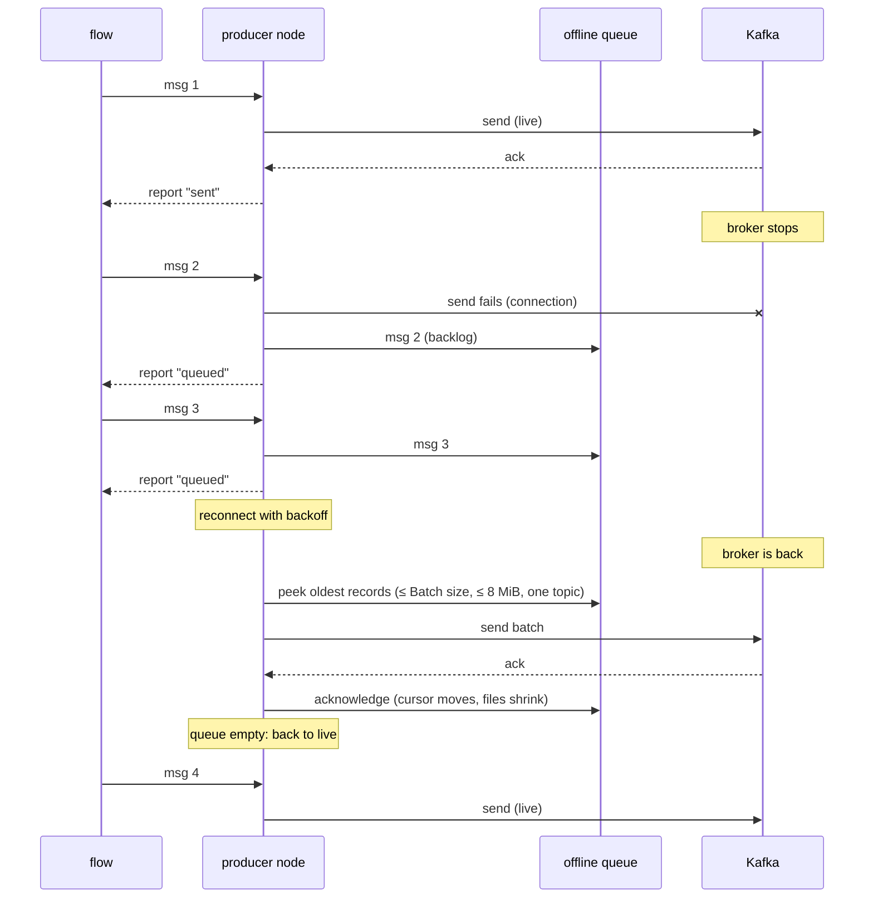

# The offline queue (store-and-forward)

The producer node keeps messages that it cannot send right now, in their original order, and sends them once
Kafka is reachable again. This document describes how that works in depth: the data flow, the file format, what
is guaranteed, what is not, and how to inspect a queue or resend messages that could not be delivered. The
settings themselves are listed in the [README](../README.md#offline-queue-store-and-forward), and the code is in
[`lib/disk-queue.js`](../lib/disk-queue.js), [`lib/memory-queue.js`](../lib/memory-queue.js) and
[`nodes/kafka-producer.js`](../nodes/kafka-producer.js).

- [Data flow: live and backlog](#data-flow-live-and-backlog)
- [Where the files are](#where-the-files-are)
- [On-disk format](#on-disk-format)
- [Writing: group commit and fsync](#writing-group-commit-and-fsync)
- [Sending and acknowledging](#sending-and-acknowledging)
- [Crash recovery](#crash-recovery)
- [Ordering and delivery guarantees](#ordering-and-delivery-guarantees)
- [Limits: overflow, expiry and dead letters](#limits-overflow-expiry-and-dead-letters)
- [Memory mode](#memory-mode)
- [Sizing](#sizing)
- [Inspecting a queue](#inspecting-a-queue)
- [Resending dead letters](#resending-dead-letters)
- [Redeploy, rename, copy and delete](#redeploy-rename-copy-and-delete)
- [Moving all queues: the settings.js override](#moving-all-queues-the-settingsjs-override)

## Data flow: live and backlog

Every input message is converted and checked first (topic name, value, key, headers, partition, timestamp). A
message with invalid content fails at once with `done(err)` and is **never** queued, so the queue only ever holds
messages that can be sent. After that, the producer is in one of two modes:

| Mode | When | What happens to a new message |
|---|---|---|
| **live** | connected, and the offline queue is empty | Added to an in-memory list. One produce request at a time takes up to *Batch size* messages of one topic. Report `sent` once Kafka acknowledged it. |
| **backlog** | not connected (also right after a deploy, during an authentication problem, or with an invalid broker configuration), or older messages are still in the queue | Appended to the offline queue. Report `queued` (with `msg.kafka.queueSize`) once it is stored; the message is done. No second report follows when it is sent later. |

The producer switches from live to backlog when:

- **a send fails because of the connection** (broker down, timeout, network, authentication): the failed batch
  and every message waiting behind it move to the queue, in order, and the node reconnects;
- **Kafka is slow**: a request has been in flight for more than 3 s, or more than 10000 messages wait in memory.
  New messages then go to the queue instead of piling up in memory. The batch in flight is written to the queue as
  well, ahead of them; if Kafka acknowledges it after all, those records are taken out of the queue again so they
  are not sent twice.

And from backlog back to live when it is connected and the queue has been sent completely:



While the queue is being sent (status `flushing · N queued`), new messages are appended behind it, so the overall
order is kept. The flusher reads at most *Batch size* records and at most 8 MiB per round, and every produce
request carries one topic only.

## Where the files are

A disk queue lives in `<directory>/<queue name>/`:

1. **Directory**: the node's *Directory* setting; if empty, `kafkajsNcProducerQueueDir` from `settings.js`; if that
   is empty too, `kafkajs-nc-queue`. A relative path is relative to the Node-RED user directory (`~/.node-red`,
   `/data` in the Docker image); a leading `~` means the home directory of the user running Node-RED.
2. **Queue name**: the node's *Queue name* setting, or the node's id. Characters other than letters, digits, `.`,
   `_` and `-` become `_`, leading dots become `_`, and the name is cut to 100 characters.

So a producer with id `3f2a9c1e5b7d4a10` and default settings uses
`~/.node-red/kafkajs-nc-queue/3f2a9c1e5b7d4a10/`. The `queue-status` action shows the full path in
`msg.payload.queueDir`.

A `${VAR}` reference in *Directory* or *Queue name* whose variable is not set makes the queue unavailable (the log
says which variable). When the queue cannot be opened at all (permissions, a read-only file system, the same queue
name used by another producer), the producer logs `Offline queue unavailable (<dir>): <reason> — messages cannot be
stored while Kafka is unreachable` and works without a queue: status `connected · queue unavailable` while
connected, and messages fail with `done(err)` while not connected.

## On-disk format

| File | Content |
|---|---|
| `seg-<16 digits>.jsonl` | **Segments**: the queued records, one JSON object per line, each line ending with `\n`. The number is a sequence number, so the files sort in queue order. A new segment is started when the current one would grow beyond 4 MiB; a single record larger than that gets a segment of its own. |
| `cursor.json` | `{"seg":<segment number>,"off":<byte offset>}`: the position of the oldest record that has not been sent yet. Missing means "the start of the oldest segment". |
| `cursor.json.tmp` | Only exists for a moment while the cursor is replaced; a leftover one is deleted on the next start. |
| `dead-letter.jsonl` | Records that could not be delivered, one JSON object per line (see [dead letters](#dead-letters)). |
| `dead-letter.1.jsonl` | The previous dead-letter file, after it reached 50 MiB. A second rotation replaces it. |

When the queue becomes empty, the segments and `cursor.json` are deleted; the directory and the dead-letter files
stay.

### Records

Every line of a segment is one Kafka message:

```json
{"v":1,"t":"telemetry","tf":0,"ts":1793188800000,"m":{"k":{"s":"sensor-1"},"v":{"s":"{\"temp\":21.5}"},"h":{"source":{"s":"line-3"}},"ts":"1793188800000"}}
```

| Field | Meaning |
|---|---|
| `v` | Record format version, currently `1`. A record with another version is not sent: it is moved to the dead-letter file. |
| `t` | The topic. |
| `tf` | `1` when the topic came from the message (`msg.topic` or an element of `msg.messages`), `0` when it is the node's *Topic* setting. It decides what happens when Kafka says the topic does not exist or is not authorised: a topic from a message only affects that message (dead letter), a configured topic is a connection problem (retry). |
| `ts` | When the message reached the producer, in milliseconds since the epoch. Used for *Expire after* and `oldestTs` in `queue-status`. |
| `m` | The Kafka message: `k` key, `v` value, `h` headers, `p` partition, `ts` the Kafka timestamp. Missing fields are left out. |
| `id` | Only on records that were in flight when the producer switched to backlog mode because Kafka was slow: a unique id that lets the producer remove exactly these records if Kafka acknowledges the original request after all. |

### Byte encoding

Kafka keys, values and header values are bytes. The record keeps them in a JSON-safe form:

| Stored as | Meaning |
|---|---|
| `{"s": "text"}` | A string. Kafka receives its UTF-8 bytes. Objects and arrays were turned into JSON text, and numbers, booleans and dates into text, before they were queued, so they are stored as `s` too. |
| `{"b": "<base64>"}` | Binary data (a Buffer or typed array), base64-encoded so that any byte survives JSON. This makes binary payloads about a third larger on disk. |
| `null` | No value: a tombstone (`v`). A message without a key has no `k` at all. |

Headers are an object `{ "name": <encoded value> }`; a header that repeats has an array of encoded values. The
partition `p` is a number. The Kafka timestamp `m.ts` is a string of milliseconds (it can be larger than
JavaScript's safe integers). It is always set, to the arrival time unless the message had `msg.timestamp`, so a
message sent hours later from the queue keeps the time it was produced.

### Dead letters

Each line of `dead-letter.jsonl` is one record that could not be delivered:

```json
{"ts":"2026-10-28T12:05:00.000Z",
 "error":{"name":"KafkaJSProtocolError","message":"...","kind":"message","reason":"MESSAGE_TOO_LARGE","retriable":false,"type":"MESSAGE_TOO_LARGE"},
 "record":{"v":1,"t":"telemetry","tf":0,"ts":1793188800000,"m":{"v":{"s":"..."},"ts":"1793188800000"}}}
```

(shown on three lines here; in the file it is one line)

- `ts`: when it was dead-lettered (ISO 8601).
- `error`: why. For errors it is an object with `name`, `message` (the whole cause chain), `kind`, `reason`,
  `retriable` and, when known, `code` and `type`. For expired records it is a string such as
  `"expired: queued longer than 24 h (queueMaxAgeHours)"`.
- `record`: the record exactly as it was queued. A damaged queue line that is not valid JSON is kept as `raw` (the
  text of the line) instead.

## Writing: group commit and fsync

- All file operations of a queue run one after another on one internal chain, so appends, reads and
  acknowledgements never interleave.
- A message counts as queued (and its `queued` report is sent) only after its bytes are written, and with *Sync
  every write to disk* on (the default), after `fdatasync()` returned. A new segment file also syncs the directory,
  so the file itself survives a power loss.
- **Group commit:** appends that arrive while a write is in progress are collected and written together, with a
  single sync, in the order they arrived. Many small messages therefore cost few disk syncs.
- All Kafka messages of one input message (`msg.messages`) are appended all-or-nothing: if the write fails, what
  was written of it is truncated again and the input fails with `done(err)` (`Could not store the message in the
  offline queue: ...`). The same happens when the disk is full.
- Without *Sync every write to disk*, data reaches the disk when the operating system flushes its cache. A crash of
  Node-RED loses nothing that was reported `queued`; a power loss or a kernel crash can lose the last messages.
- File systems that cannot sync at all (some FUSE, 9p or SMB mounts) are detected: the queue logs `the file system
  does not support fsync (...)` once and carries on without syncing.

## Sending and acknowledging

After the reconnect, the flusher repeats: read the oldest records from the cursor onwards, send them in one
request, then **acknowledge** them. Acknowledging moves the cursor behind the last record handled and writes
`cursor.json` atomically (write `cursor.json.tmp`, sync it, rename it over `cursor.json`, sync the directory).
Segments that lie completely before the cursor are deleted. When nothing is left, the segments and the cursor file
are deleted and the producer returns to live mode, logging `Sent N queued message(s) to Kafka; the offline queue is
empty`.

Records that Kafka refuses for good are appended to the dead-letter file, acknowledged like sent records, and
sending continues with the next one (see [dead letters](#limits-overflow-expiry-and-dead-letters)). If the queue
itself fails while sending (for example a read error), the producer logs `Offline queue error while sending queued
messages: ...` and tries again with a growing delay; the records stay where they are.

## Crash recovery

When a producer starts, the queue is opened and repaired:

1. The directory is created if needed and checked for read and write access.
2. A leftover `cursor.json.tmp` is deleted: the rename never happened, so the old `cursor.json` is still valid.
3. A **torn last line** in the newest segment (a write interrupted by a crash, without its `\n`) is cut off. That
   message had not been reported `queued` yet, so nobody was told it was safe.
4. The cursor is checked. A missing cursor means the start of the oldest segment. A cursor that cannot be read, that
   points past the newest segment, or whose offset is not at the start of a line is not trusted: the queue logs a
   warning and sends the affected segment(s) again from the start (`messages may be sent twice`). A cursor beyond
   the end of its segment is moved to the end. A cursor naming a segment that no longer exists means the start of
   the next one.
5. Segments before the cursor, left behind by a crash during their deletion, are deleted.
6. The waiting records are counted (streaming, in 64 KiB chunks), and the producer logs `The offline queue holds N
   message(s) from earlier; they are sent first once Kafka is reachable`.

A damaged line in the middle of a segment (not valid JSON) is not a reason to stop: it is handed to the flusher as
a corrupt entry, which moves its raw text to the dead-letter file and continues.

These cases are covered by the tests in [`test/unit/disk-queue.spec.js`](../test/unit/disk-queue.spec.js),
including a child process that is killed with `SIGKILL` at random moments while it appends and acknowledges, after
which no confirmed record may be missing, duplicated or out of order.

## Ordering and delivery guarantees

**Order.** The queue is first-in, first-out, and the producer sends one request at a time, both live and from the
queue. Messages that move from memory to the queue keep their position. Kafka itself keeps order only **per
partition**, so give messages whose order matters the same key or a fixed partition. Separate producer nodes have
separate queues and are independent of each other.

**At least once.** A message reported `sent` was acknowledged by Kafka (with *Acknowledgement* `all` or `leader`);
a message reported `queued` is stored. Messages are sent again, so a consumer can see a **duplicate**, when:

- the connection broke after Kafka wrote a batch but before its answer arrived: the batch is still queued and is
  sent again after the reconnect;
- Node-RED crashed or was killed after a batch was sent but before the new cursor was written;
- on close, a request did not answer within 5 s: its messages are stored in the queue although Kafka may still
  write them;
- Kafka was slow, the batch in flight was copied to the queue, and removing it again failed (rare);
- the cursor file was damaged and a segment is sent again from its start;
- kafkajs retried a request internally within one connection (the *Idempotent producer* option prevents only this
  last case).

Consumers that must not process a message twice should de-duplicate, for example by a unique id in a header.

**When messages are not delivered.** Never silently, but in these cases on purpose or by necessity:

| Case | What happens |
|---|---|
| Invalid content (no topic, invalid topic name, `undefined` payload, ...) | `done(err)` at once, never queued |
| The queue is full, *Drop the oldest* | the oldest queued messages are removed, with a warning (`queue full (limit ...): dropped N oldest message(s) to make room`) |
| The queue is full, *Reject new messages* | the new message fails with `done(err)` |
| One message larger than the whole limit | always fails with `done(err)` |
| Queued longer than *Expire after* | moved to the dead-letter file instead of being sent |
| Kafka refuses a queued message for good | moved to the dead-letter file |
| `msg.action = "queue-clear"` | every queued message is deleted, with a warning |
| Memory mode and a redeploy or restart | queued messages are discarded, with a warning |
| Power loss with *Sync every write to disk* off | the last messages written may be lost |
| Node-RED dies before a message got its report | the message may be lost, as with any Node-RED node |
| The dead-letter file cannot be written | the record is dropped and logged as an error with its content (first 500 characters) |

## Limits: overflow, expiry and dead letters

- **Maximum size** (default 100 MB, `0` = unlimited, fractions allowed) counts the bytes of the stored JSON lines,
  newline included. **Maximum messages** (default `0` = unlimited) counts records; a `msg.messages` batch counts as
  one record per Kafka message.
- **When full** decides what a new message does when it would exceed a limit:
  - *Drop the oldest* (`drop-oldest`, default): the oldest queued records are removed until the new message fits.
    The cursor moves forward, as if they had been sent. `droppedTotal` in `queue-status` counts them.
  - *Reject new messages* (`drop-newest`): nothing is removed; the new message fails with `done(err)` (`Offline
    queue <dir> is full (N messages queued, limit ...); message rejected (overflow policy drop-newest)`).
- **Expire after** (hours, `0` = never) is checked while the queue is being sent, not while it waits: an expired
  record is moved to the dead-letter file instead of being sent. Until then it still counts towards the limits.
- **Dead letters.** A queued record is moved to the dead-letter file, with a warning (`Moved a queued message for
  topic X that cannot be delivered to <dir>/dead-letter.jsonl: <reason>`), when:
  - Kafka refuses it for good: *message too large*, *batch too large*, an invalid topic, a partition that does not
    exist, and other errors of kind `message` (see [ARCHITECTURE.md](ARCHITECTURE.md#error-classification));
  - its topic came from the message and Kafka says the topic does not exist or is not authorised;
  - it expired, or its line is damaged or in an unknown format;
  - a batch failed 5 times in a row with an error the node does not recognise: the batch is then sent record by
    record, and records that still fail that way are dead-lettered, so one odd record cannot block the queue.

  When a batch is refused because of one bad record, the batch is sent record by record so that only the bad one is
  dead-lettered. Connection, authentication and configuration problems never dead-letter anything: the records
  stay queued until the problem is fixed.

## Memory mode

*Offline queue: In memory* uses the same rules for order, limits, overflow and expiry, with these differences:

- Nothing survives a redeploy, a restart or a crash. On close the queue logs `Memory queue closed with N unsent
  message(s); they are discarded`, and messages still waiting for the connection fail with `done(err)`.
- Records are still converted to their JSON form when they are queued, so *Maximum size* means the same as on disk.
- Dead letters are counted (`deadLettered`) and logged with their reason. The last 100 are kept in memory only;
  they cannot be read from a flow, so the content of a dead-lettered message is not recoverable.
- *Directory*, *Queue name* and *Sync every write to disk* do not apply.

Use it for short outages, read-only file systems, or data that must not be written to disk.

## Sizing

What one record takes on disk (measured with the current format, key `sensor-1`, topic `telemetry`):

| Payload | Line size |
|---|---|
| `{ "temp": 21.5 }` | 126 bytes |
| a JSON object of about 70 characters | 184 bytes |
| a 1000-character string | 1111 bytes |
| a 1000-byte Buffer | 1447 bytes (base64) |

So the overhead is roughly 110 bytes plus the payload (plus a third for binary payloads). The default limit of
100 MB holds about 800000 small JSON readings. To size the queue for an outage you want to survive:

```
size ≈ messages per second × seconds of outage × bytes per record
     = 10 × 86400 (one day) × 200 bytes ≈ 173 MB
```

Recommendations:

- **Leave room for the system.** The limit is a ceiling for the queue, not a reservation. On a small SD card set
  *Maximum size* well below the free space, and use *Expire after* when old data is worthless anyway.
- **SD cards and flash wear.** With *Sync every write to disk* every group of appends is one write plus a sync.
  At high message rates this means many small writes. Options: send fewer, larger input messages (`msg.messages`
  batches are appended in one write); move the queues to a USB SSD with `kafkajsNcProducerQueueDir`; or turn the
  sync off if the device has a reliable power supply (a crash of Node-RED still loses nothing).
- **Disk full.** A message that cannot be written fails with `done(err)`; nothing already queued is affected.
- **Memory use** does not grow with the size of a disk queue: records are read in 64 KiB chunks and each send round
  is limited to *Batch size* records and 8 MiB.
- **One Node-RED per directory.** The lock that prevents two producers from using the same queue directory only
  works within one Node-RED process. Never let two Node-RED instances share a queue directory (for example on a
  network drive); use a local disk.
- **Containers.** Keep the user directory, or the directory set in `kafkajsNcProducerQueueDir`, on a volume, or the
  queue is lost when the container is recreated.
- **Privacy.** The files hold message contents in plain text. Protect the directory with file permissions or disk
  encryption, or use the memory mode for sensitive data (see [SECURITY.md](../SECURITY.md)).

## Inspecting a queue

From a flow, send `msg.action = "queue-status"` to the producer. It answers with `msg.payload` = `{ size, bytes,
segments, droppedTotal, deadLettered, oldestTs, state, mode, queueMode, queueDir, pending }` (plus `queueError` and
`lastError` after a problem); the fields are explained in the
[README](../README.md#monitoring-the-queue).

On the file system, the files are plain JSON lines, so standard tools work:

```sh
cd ~/.node-red/kafkajs-nc-queue/<queue name>
ls -l                          # segments, cursor.json, dead-letter files
cat cursor.json                # {"seg":3,"off":51234}: everything before byte 51234 of seg-…03 was sent
wc -l dead-letter.jsonl        # how many messages could not be delivered
tail -n 1 dead-letter.jsonl    # the last one, with its error
```

`wc -l seg-*.jsonl` counts the lines already sent from the first segment too. The script below lists only what is
still waiting. It only reads the files, so it can run while Node-RED is running (a line that is being written at
that moment is skipped).

<!-- snippet: inspect-queue (tested by test/unit/docs-snippets.spec.js) -->
```js
// inspect-queue.js — usage: node inspect-queue.js ~/.node-red/kafkajs-nc-queue/<queue name>
'use strict';
const fs = require('fs');
const path = require('path');

const dir = process.argv[2];
let cursor = { seg: 0, off: 0 };
try {
    cursor = JSON.parse(fs.readFileSync(path.join(dir, 'cursor.json'), 'utf8'));
} catch (_) {
    // no cursor.json: nothing of the oldest segment has been sent yet
}
const show = (e) => (e === undefined ? '-' : e === null ? 'null'
    : e.b !== undefined ? `<${Buffer.from(e.b, 'base64').length} bytes>` : e.s);
let waiting = 0;
for (const file of fs.readdirSync(dir).filter((f) => /^seg-\d{16}\.jsonl$/.test(f)).sort()) {
    const seg = Number(file.slice(4, 20));
    if (seg < cursor.seg) continue; // already sent, about to be deleted
    const bytes = fs.readFileSync(path.join(dir, file)).subarray(seg === cursor.seg ? cursor.off : 0);
    for (const line of bytes.toString('utf8').split('\n').slice(0, -1)) { // the last part is '' or being written
        waiting++;
        try {
            const r = JSON.parse(line);
            console.log(new Date(r.ts).toISOString(), r.t, 'key:', show(r.m.k), 'value:', show(r.m.v).slice(0, 80));
        } catch (_) {
            console.log('damaged line (it will go to the dead-letter file):', line.slice(0, 80));
        }
    }
}
console.log(`${waiting} message(s) waiting in ${dir}`);
```

## Resending dead letters

Dead letters are not resent automatically, because most of them fail for a reason that has to be fixed first.
Before resending, check `error` in the file and fix the cause: raise the topic's `max.message.bytes` for *message
too large*, create the topic or grant the ACL, or remove the partition for a partition that does not exist.

A flow that resends them:

1. A **file in** node: *Filename* = the full path of `dead-letter.jsonl`, *Output* = *a msg per line*.
2. The **function** node below.
3. A **kafka producer** whose *Topic*, *Key* and *Partition* are **empty** (the values come from each message) and
   with *Also send msg.headers* ticked.
4. Trigger the file in node with an *inject* node. When everything was resent, rename or delete the dead-letter file
   so that the same messages are not sent again later.

<!-- snippet: replay-dead-letters (tested by test/unit/docs-snippets.spec.js) -->
```js
// function node: one line of dead-letter.jsonl (msg.payload) → one message for a kafka producer
if (!msg.payload.trim()) return null; // the empty part after the last newline
const entry = JSON.parse(msg.payload);
if (!entry.record) {
    node.warn(`Skipped a damaged queue line: ${entry.raw}`);
    return null;
}
const m = entry.record.m;
const bytes = (e) => (e === undefined || e === null ? e : e.b !== undefined ? Buffer.from(e.b, 'base64') : e.s);
const headers = {};
for (const [name, value] of Object.entries(m.h || {})) {
    headers[name] = Array.isArray(value) ? value.map(bytes) : bytes(value);
}
return {
    topic: entry.record.t,
    payload: bytes(m.v),    // null = tombstone
    key: bytes(m.k),        // undefined or null = no key
    headers,
    partition: m.p,         // undefined = the partitioner decides
    timestamp: m.ts         // the original Kafka timestamp
};
```

The resent messages go through the producer like any other message: they get a new delivery report, and if Kafka
is unreachable they are queued again.

## Redeploy, rename, copy and delete

The queue directory is derived from the node's settings and, by default, from the node's **id**. What happens to
queued messages when the node changes:

| You... | The node id | What happens to the queue |
|---|---|---|
| deploy (full, modified flows or modified nodes), or restart Node-RED | stays the same | The old instance stores everything unsent and closes the queue; the new instance waits for that (up to 12 s), opens the same directory and sends the backlog first. |
| change *Directory* or *Queue name* | stays the same | The node uses the new directory. The old one is **not** sent; set the old values again to send it. |
| change *Offline queue* to *In memory* or *Off* | stays the same | The disk queue is no longer read; its files stay. |
| copy and paste, import, or duplicate the node | **new id** | Without a *Queue name*, the copy gets a new, empty queue named after its new id. With a *Queue name*, the copy has the same name: give it its own, or it runs without a queue while the original exists (see the last row). |
| delete the node | – | The files stay on disk. If messages were left, a warning names the directory: `Node removed with N unsent message(s) left in <dir>`. |
| give two producers the same *Queue name* (and directory) | – | The second one cannot lock the directory, logs `Queue directory ... is already used by node <id>` and runs without a queue. |

**Production advice:** give every producer that matters a *Queue name*. The queue then survives replacing the node,
for example deleting it and importing it again. To send an orphaned queue (for example the directory of a deleted
node, named after its id), set a producer's *Queue name* to the directory's name and deploy; the messages are sent
once that producer is connected. Only do this with Node-RED's own queue directories, and only for one producer at a
time.

Deleting a queue: send `msg.action = "queue-clear"` to the producer, or stop Node-RED and delete the directory.

## Moving all queues: the settings.js override

An administrator can change the default directory for every producer whose *Directory* is empty, for example to a
larger disk, in Node-RED's `settings.js`:

```js
module.exports = {
    // ...
    kafkajsNcProducerQueueDir: '/var/lib/node-red/kafka-queue',
};
```

Relative paths are resolved against the user directory, and `~` is the home directory. The setting is read when a
producer starts, so restart Node-RED after changing it. Queues in the old location are not moved: stop Node-RED
and move the queue directories over before starting it again. The setting is not exposed to the editor.
